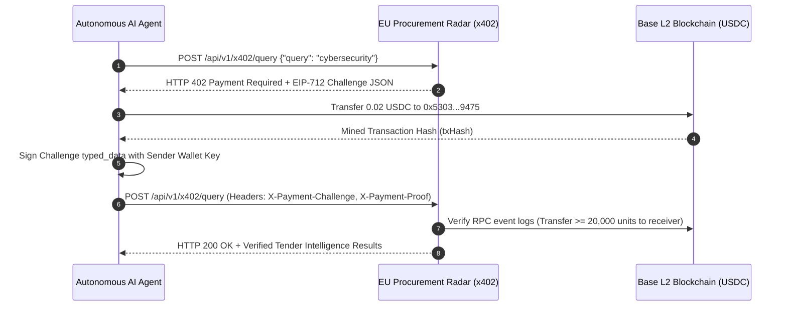

# EU Procurement Radar — x402 Micropayment API

[-0052FF?logo=coinbase)](https://base.org)
[](https://basescan.org/token/0x833589fCD6eDb6E08f4c7C32D4f71b54bdA02913)
[](https://github.com/coinbase/agentkit)
[](LICENSE)

> Autonomous Machine-to-Machine (M2M) API for AI agents and Web3 bots to query verified European Union public procurement tenders, buyer requirements, and CPV codes via instant Base L2 USDC micropayments ($0.02 USDC / query).

---

## 🌐 Public Live Endpoints

- **Live Service URL**: `https://inside-petite-legacy-reduces.trycloudflare.com`
- **x402 Protocol Manifest**: [`/.well-known/x402.json`](https://inside-petite-legacy-reduces.trycloudflare.com/.well-known/x402.json)
- **AI Agent Discovery Manifest**: [`/.well-known/ai-agent.json`](https://inside-petite-legacy-reduces.trycloudflare.com/.well-known/ai-agent.json)
- **Tender Query Endpoint**: `POST /api/v1/x402/query`
- **Tender Detail Endpoint**: `GET /api/v1/x402/tender/{tender_id}`
- **Service Health**: [`/healthz`](https://inside-petite-legacy-reduces.trycloudflare.com/healthz)

---

## ⚡ Pricing & Settlement Parameters

| Parameter | Value |
|---|---|
| **Network** | Base L2 (`eip155:8453`) |
| **Token Contract** | `0x833589fCD6eDb6E08f4c7C32D4f71b54bdA02913` (USDC on Base) |
| **Receiver Address** | `0x53034d57d66c0Ce3635F04AF924603d5ef349475` |
| **Price per Query** | **0.02 USDC** (`20,000` base units / 6 decimals) |
| **Settlement Protocol** | `x402-receipt-eip712` / EIP-3009 exact transfer |

---

## 🤖 How It Works (Autonomous M2M Flow)



---

## 💻 Agent Client Integration (Python)

```python
import httpx
import json
from eth_account import Account
from eth_account.messages import encode_typed_data

RADAR_URL = "https://inside-petite-legacy-reduces.trycloudflare.com"
WALLET_KEY = "0x..." # Your agent private key with Base USDC balance

async def query_eu_tenders(search_term: str):
    async with httpx.AsyncClient() as client:
        # 1. Initiate query -> receives HTTP 402 challenge
        payload = {"query": search_term, "limit": 10}
        resp = await client.post(f"{RADAR_URL}/api/v1/x402/query", json=payload)
        
        if resp.status_code == 402:
            challenge = resp.json()["detail"]
            challenge_id = challenge["challenge_id"]
            
            # 2. Transfer 0.02 USDC to receiver on Base (using web3.py / eth_account)
            # tx_hash = send_usdc_transfer(to=challenge["pay_to"], amount=0.02)
            tx_hash = "0x..." 
            
            # 3. Sign EIP-712 challenge binding the txHash
            typed_data = challenge["typed_data"]
            typed_data["message"]["txHash"] = tx_hash
            sig = Account.sign_message(encode_typed_data(full_message=typed_data), WALLET_KEY).signature.hex()
            
            # 4. Replay request with payment proof
            headers = {
                "X-Payment-Challenge": challenge_id,
                "X-Payment-Proof": json.dumps({"tx_hash": tx_hash, "signature": "0x" + sig})
            }
            paid_resp = await client.post(f"{RADAR_URL}/api/v1/x402/query", json=payload, headers=headers)
            return paid_resp.json()
```

---

## 📦 Query Parameters (`POST /api/v1/x402/query`)

| Field | Type | Description |
|---|---|---|
| `query` | string | Free-text search across tender titles & descriptions (max 500 chars). |
| `cpv` | string | European CPV prefix (2 to 8 digits, e.g. `72000000` for IT services). |
| `min_value` | number | Minimum estimated tender value in EUR. |
| `country` | string | 3-letter ISO country code (e.g. `PRT`, `ESP`, `FRA`, `DEU`). |
| `limit` | integer | Max records to return (1-100, default 20). |

---

## 🔒 Security & Verification Guarantees

- **No Shared Secrets**: The server never asks for or stores private keys.
- **Replay Protection**: Every challenge is cryptographically bound to a unique `challenge_id`, HTTP request path, and payload hash. Replaying an expired or consumed challenge is rejected with `HTTP 409 Conflict`.
- **On-Chain Verifiability**: Every transfer is verified directly against Base L2 RPC event logs (`Transfer(address,address,uint256)`).

---

## 📄 License

MIT License. Designed for open Web3 and autonomous AI agent architectures.
